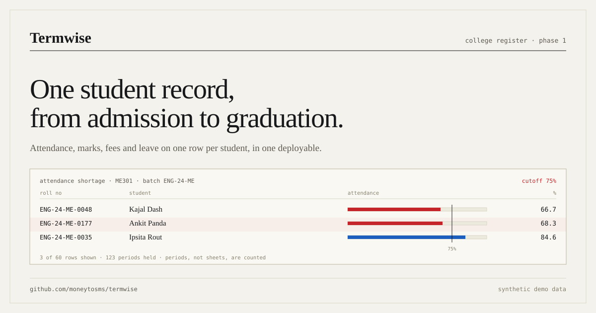
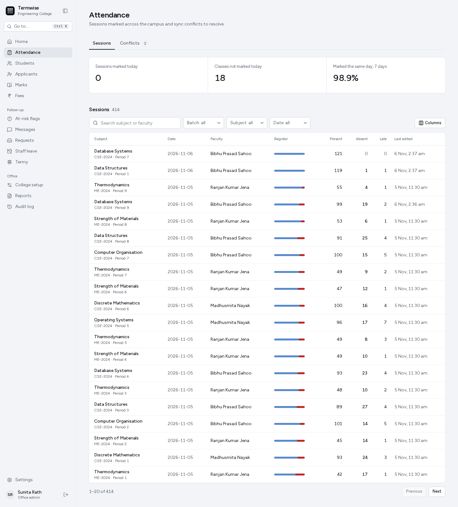

<p align="center">
  
</p>

# Termwise

**One college record, from admission to graduation.** Termwise is a college ERP for a trust running three campuses. A teacher marks attendance on a phone with no signal; the office gets the sheet later, and no one types the same student twice.

[Try the demo](https://termwise-s1vj.onrender.com) · [Project site](https://moneytosms.github.io/termwise/) · [Guide](https://moneytosms.github.io/termwise/guide/) · [Technical design](docs/tdd.md) · [Deployment](docs/deployment.md)

The demo runs on a free instance, so the first load can take a minute. Every account and record is synthetic. Sign in as `cse.faculty@termwise.demo` (faculty) or `eng.admin@termwise.demo` (office admin); the sign-in page shows the demo password.



## What it does

- **Attendance in class, offline.** Home opens on today's classes. Everyone starts present and one tap marks an absentee. A saved sheet waits in the phone's outbox and syncs later, without overwriting another teacher's sheet.
- **Marks with a moderation lock.** Faculty enter internal components; the office locks a submitted subject. A reopen needs a typed reason, every change is audited, and an accepted appeal can correct one locked mark. A locked subject exports as the university upload CSV.
- **Fees that add up.** Due is instalment minus scholarship minus payments, calculated rather than stored. Receipts print with the amount in words, a keyed HMAC and a QR code, and a public page verifies them. Receipts export as Tally vouchers.
- **A portal for students and parents.** Attendance with a planner, marks by component, marksheets for locked subjects, fees, leave and messages in English or Odia. Every query is pinned to the signed-in student or a linked child.
- **An assistant that can only read.** Plain-English questions become a checked `SELECT` over six views, run as a read-only role. Each answer shows its filters, its row count and the SQL, so staff can see what was counted.
- **Reports for the office.** Strength, shortage, marks and fees, plus the AICTE and NAAC returns, from the same rows the screens read.

## Offline attendance

Attendance is taken where the Wi-Fi is not.

1. **Queue.** Today's classes and rosters (names and roll numbers only) sit in IndexedDB. A saved sheet waits in an outbox and the class shows as queued.
2. **Send.** The outbox flushes when the app opens, when the network returns, or through Background Sync on Android. Each item is decided on its own.
3. **Decide.** The server answers each sheet: saved, stale (an older edit), conflict (another teacher saved first, so it goes to the office queue) or rejected (marked by a different teacher on a shared phone).
4. **Correct.** Edit times are fixed up for a wrong phone clock using the gap between the phone and the server at send.

The at-risk flag is strict by design: a student below 75% in a subject gets a mentor task from a fixed rule. The assistant may reword the reason; it never decides the flag, and it cannot write.

## Run it

```bash
git clone https://github.com/moneytosms/termwise.git && cd termwise
pnpm install
docker compose up -d db
pnpm db:migrate && pnpm db:seed
pnpm dev
```

Node 24 or later, pnpm 12.15 and Postgres 18. Open <http://localhost:3000> and use a login above. Env vars, the daily job, Docker and the load test are in [docs/deployment.md](docs/deployment.md).

## Scope

- **Messages are logged, not sent.** No SMS or WhatsApp gateway is connected, and the Odia parent templates need a native speaker's review.
- **Payments are test mode.** No gateway, no real money.
- **The assistant needs a key.** It runs on Gemini or Groq with a daily call cap. Without a key it says so and points to the normal lists.
- **Verification shows a minimum.** The public receipt and mark sheet pages show totals and a masked name, never the full record.

## Built with

Next.js 16 with server components and server actions, Postgres 18 with the assistant's read-only views, Drizzle, Better Auth, Dexie and a hand-written service worker for offline, and the Vercel AI SDK with a structured plan schema. The last full run recorded in the design document: 232 unit tests and 88 Playwright runs, green on a fresh database.

Tests: `pnpm test` (Vitest) and `E2E=1 pnpm e2e` (Playwright, phone viewport). Typecheck: `pnpm typecheck`.
